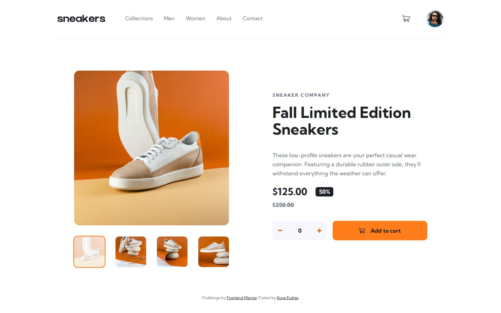

# Frontend Mentor - E-commerce product page solution

This is a solution to the [E-commerce product page challenge on Frontend Mentor](https://www.frontendmentor.io/challenges/ecommerce-product-page-UPsZ9MJp6). Frontend Mentor challenges help you improve your coding skills by building realistic projects.

## Table of contents

- [Overview](#overview)
  - [The challenge](#the-challenge)
  - [Screenshot](#screenshot)
  - [Links](#links)
- [My process](#my-process)
  - [Built with](#built-with)
  - [Workflow](#workflow)
  - [What I learned](#what-i-learned)
  - [Continued development](#continued-development)
  - [Useful resources](#useful-resources)
  - [AI Collaboration](#ai-collaboration)
- [Author](#author)

## Overview

### The challenge

Users should be able to:

- View the optimal layout for the site depending on their device's screen size
- See hover states for all interactive elements on the page
- Open a lightbox gallery by clicking on the large product image
- Switch the large product image by clicking on the small thumbnail images
- Add items to the cart
- View the cart and remove items from it

### Screenshot



### Links

- Solution URL: added after submission
- Live Site URL: [ounokoya.github.io/ecommerce-product-page](https://ounokoya.github.io/ecommerce-product-page/)

## My process

### Built with

- Semantic HTML5 markup, native `<dialog>` for the lightbox and the mobile menu
- [Tailwind CSS v4](https://tailwindcss.com/) — design tokens in `@theme`, default palette removed, repeated groups as `@utility`
- Vanilla JavaScript, one ES module per feature (`cart.js`, `gallery.js`, `menu.js`, shared `dialog.js`)
- Mobile-first layout with Flexbox and CSS Grid (mobile < 640 px, tablet 640–1023 px, desktop ≥ 1024 px)
- Kumbh Sans served with the site through [Fontsource](https://fontsource.org/fonts/kumbh-sans) (no request to another domain)
- [Vite](https://vite.dev/) for the build, deployed on GitHub Pages from the `gh-pages` branch (`npm run deploy`)
- [Playwright](https://playwright.dev/), [axe-core](https://github.com/dequelabs/axe-core) and the W3C Nu validator for tests

### Workflow

Before any code, the design was analysed and rebuilt:

1. **Visual analysis in Excalidraw** — every screen measured in px, inventory of all interactive elements and their states, contrast checks → [`specs/visuel/`](./specs/visuel/)
2. **Penpot mockup and prototype** — colour and type library, 16 components with their states, 15 screens (including a tablet proposal), click-through prototype, visual thresholds calibrated per screen → [`specs/visuel/penpot/`](./specs/visuel/penpot/)
3. **Spec, then tests** — 30 Given/When/Then scenarios and the accessible names the tests rely on → [`specs/specifications/`](./specs/specifications/); the 40 Playwright tests were written right after the spec, before the code
4. **Decisions** — font loading, JS organisation, modals and cart popover chosen among options → [`specs/adr/`](./specs/adr/)
5. **Code** — one commit per part (theme, layout, cart, gallery, menu), tests run at each step → [`specs/analyse/`](./specs/analyse/) for the validation report

### What I learned

**The native `<dialog>` does most of the modal work.** `showModal()` gives Escape, an inert background, the top layer and focus restoration. Only the click on the backdrop needs code, because its target is the dialog itself:

```js
dialog.addEventListener('click', (event) => {
  if (event.target !== dialog) return
  const box = dialog.getBoundingClientRect()
  const outside = event.clientX < box.left || event.clientX > box.right || event.clientY < box.top || event.clientY > box.bottom
  if (outside) dialog.close()
})
```

**One state, two views.** The page gallery and the lightbox are both rendered from the same `current` index, so closing the lightbox keeps the last image viewed without any syncing code:

```js
function show(index) {
  current = (index + count) % count // the arrows loop
  for (const view of views) {
    view.querySelectorAll('[data-slide]').forEach((slide, i) => { slide.hidden = i !== current })
    for (const thumb of view.querySelectorAll('[data-show]')) {
      thumb.setAttribute('aria-pressed', String(Number(thumb.dataset.show) === current))
    }
  }
}
```

**Styling from ARIA state.** The active thumbnail is styled from `aria-pressed`, so what a screen reader announces and what the eye sees cannot diverge:

```css
@utility thumb {
  &[aria-pressed="true"] { @apply ring-2 ring-orange; }
  &[aria-pressed="true"] > img { opacity: 0.25; }
}
```

**Testing through accessible names.** The tests only use roles and names (`getByRole('button', { name: 'Add to cart' })`), never classes, so they double as an accessibility check and leave the markup free.

### Continued development

- **Accessibility vs. pixel-perfect.** Four design colours were below WCAG thresholds and were changed: the old price (Dark grayish blue, 5.0:1), the cart badge digit (Very dark blue on Orange, 6.4:1), the − / + icons (darker orange `hsl(26, 100%, 46%)`, 3.1:1) and the delete icon (Dark grayish blue, 4.9:1 instead of 1.6:1).
- **Visual comparison with the design files.** Screenshots differ from the Frontend Mentor JPGs by 0.5–4.8 % of pixels. On mobile, the browser renders Kumbh Sans about 3 % wider than the JPG, so one line of the description wraps differently; I did not tighten the letter spacing to match a picture.
- **No tablet design** was provided: the tablet layout (centred 550 px photo and content) is my own proposal.
- **Cart behaviour choices**: the quantity selector goes back to 0 after adding, and quantities add up in the cart.

### Useful resources

- [MDN — The Dialog element](https://developer.mozilla.org/en-US/docs/Web/HTML/Reference/Elements/dialog) — `showModal()`, `::backdrop`, the `close` event.
- [Tailwind CSS — Theme variables](https://tailwindcss.com/docs/theme) — `@theme`, namespaces and resetting the default palette.
- [WebAIM — Contrast checker](https://webaim.org/resources/contrastchecker/) — to check the design colours.

### AI Collaboration

I used **Claude (Claude Code)** as a pair, inside a spec-driven workflow where I validated each step before the next one:

- **Planning**: choosing the challenge and writing the plan, which I validated.
- **Design analysis**: measuring the JPG designs and drawing the annotated Excalidraw analysis, which I reviewed; I decided the contrast fixes, the tablet layout and the cart behaviour.
- **Mockup**: building the Penpot library, components, screens and prototype, which I validated.
- **Spec and tests**: writing the scenarios and the Playwright tests before any code.
- **Technical decisions**: Claude presented options with their trade-offs and I chose (Fontsource, one module per feature, native `<dialog>`, cart button with `aria-expanded`).
- **Code**: written by Claude from the validated spec, one commit per part, with the tests run at each step. The plan first said I would write the code with Claude as a tutor; that came from a misunderstanding of who would code, and we switched before the first line of code.

What worked well: tests written before the code gave a clear target, and the calibrated Penpot screens made the visual checks meaningful. What needed my decisions: the design's contrast issues, the tablet layout, the cart rules and the accepted visual differences.

## Author

- Frontend Mentor - [@ounokoya](https://www.frontendmentor.io/profile/ounokoya)
- GitHub - [@ounokoya](https://github.com/ounokoya)
